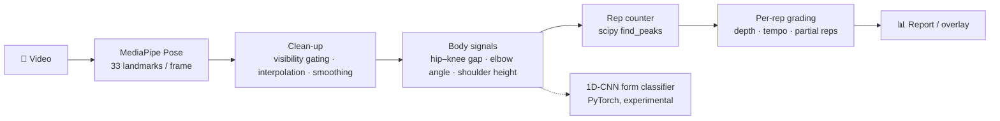

# SpotMe: AI Rep Counter & Form Checker

> Point a camera at your set. SpotMe counts your reps and tells you how each one went.

SpotMe uses **pose estimation** (MediaPipe) to track 33 body points in a workout video, turns them into signals, **counts reps**, and **grades each rep** (depth, tempo, partial reps). It also tests a small **PyTorch 1D-CNN** form classifier against classic baselines.

🚧 **Status:** research phase (Kaggle notebooks). Next up is the web app: React + Vite frontend, FastAPI backend.

---

## ✨ What it does

| Exercise                               | Counting                         | Form grading                                      | Camera                |
| -------------------------------------- | -------------------------------- | ------------------------------------------------- | --------------------- |
| **Squat**                              | ✅ any view                      | Depth (hips vs knees) · tempo (down / up seconds) | front, side, diagonal |
| **Bicep curl** (dumbbell, alternating) | ✅ per arm: `Left: 8 · Right: 8` | Partial curls (elbow never closes past 70°)       | front                 |
| **Push-up**                            | ✅ any view                      | Depth (elbow angle at the bottom, cutoff 90°)     | grading: front        |

If the camera can't see the body well enough, SpotMe says so (_"Step back so your hips and knees are visible"_) instead of guessing.

---

## 🧠 How it works



**Key ideas**

- **Measure body parts against each other, not against the image.** Squat depth is the hip-to-knee gap divided by torso length, so camera shake and distance cancel out.
- **Don't guess hidden joints.** Frames with low landmark visibility are dropped and filled in from neighbouring frames. Videos with too few trusted frames get a warning instead of a count.
- **Peaks, not thresholds.** Reps are detected with `find_peaks` (prominence + minimum gap), which works across body sizes and camera angles where fixed angle thresholds failed.
- **Free accuracy checks.** Without hand-counted labels, the two arms in an alternating curl should match (left ≈ right), and push-ups are counted with two independent signals that should agree.

---

## 📈 Results

| What                                         | Result                                                                                   |
| -------------------------------------------- | ---------------------------------------------------------------------------------------- |
| Squat counter                                | **12/12** usable test videos counted exactly · 3 low-visibility videos correctly refused |
| Curl counter (left vs right agreement)       | **94%** of front videos within 1 rep                                                     |
| Partial-curl flag                            | flagged in **1%** of "good" vs **21%** of "bad" videos                                   |
| Front-view detector                          | **100%** on Mendeley front/side/diagonal views                                           |
| Push-up counter (two signals agree within 1) | **90%** overall · front 98% · diagonal 92% · side 79%                                    |
| Push-up depth flag ("too shallow")           | **12%** of "good" vs **28%** of "bad" videos, verified by eye                            |

### 🧪 The form-classifier experiment

I trained a small **1D CNN** (PyTorch, ~28k weights) on 30-frame windows of squat landmarks to predict good vs bad form, evaluated with **5-fold cross-validation split by person**, so no person appears in both train and test.

| Model                                     | Accuracy     |
| ----------------------------------------- | ------------ |
| Random forest on summary stats (baseline) | **67% ± 9%** |
| 1D CNN                                    | 58%          |
| + per-video normalization                 | 62%          |
| + mirror augmentation                     | 60%          |

**The CNN lost to the baseline.** Looking into why, I found that the dataset's good/bad labels are often barely different, and some are wrong (see below). The bottleneck is label quality, not model capacity, so the next step is a cleaner dataset (Fitness-AQA which I requested status: waiting for the permit to use the dataset), not a bigger model.

---

## 🔍 Data problems I found along the way

- `squat_17` (Kaggle) is not a squat.
- Kaggle barbell curl #4 and #5 are the same video.
- Mendeley push-up "bad / side" for persons 14 and 20 is an identical file.
- Mendeley person 7: broken landmark data.
- Mendeley persons 4 and 22: "good" push-up videos with clearly shallow reps.
- A file-name typo (`bicep` vs `biceps`) that silently dropped videos.

## 💡 Lessons learned

1. **Relative measurements beat absolute ones.** The knee-angle counter failed from the front; the hip-to-knee gap worked from every view.
2. **100% on one dataset ≠ the real world.** The front-view detector was perfect on Mendeley but too strict on real gym footage (front-ish videos scored 63–66°).
3. **Test on the same equipment you built on.** Building on dumbbell curls and testing on barbell curls produced misleading failures.
4. **Check the labels before blaming the model.**
5. **Split by person, not by clip.** Otherwise the model memorizes people, not form.

---

## 📒 Notebooks

| Notebook                                                                         | What's inside                                                                                                                            |
| -------------------------------------------------------------------------------- | ---------------------------------------------------------------------------------------------------------------------------------------- |
| [`01-pose-extraction-and-squats`](notebooks/01-pose-extraction-and-squats.ipynb) | MediaPipe setup · squat counter (failed knee-angle v1 → hip-gap v2) · depth / tempo report · parallel landmark extraction for 444 videos |
| [`02-train-form-checker`](notebooks/02-train-form-checker.ipynb)                 | Training windows · baselines · person-wise CV · PyTorch 1D CNN · normalization & mirroring experiments                                   |
| [`03-curl-and-push-up-counters`](notebooks/03-curl-and-push-up-counters.ipynb)   | Per-arm curl counter · partial-rep grading · front-view detector · push-up counter & depth grading · video overlay                       |

All notebooks run on **Kaggle (CPU only)**. MediaPipe doesn't use the GPU here.

## 💻 Running locally

Start the API server (FastAPI, port 8000):

```bash
cd server && source .venv/bin/activate && uvicorn main:app --reload --port 8000
```

In a second terminal, start the web app (Vite proxies `/api` to the server):

```bash
cd web && npm run dev
```

## 🛠️ Tech stack

**Now:** Python · MediaPipe Pose Landmarker · NumPy / pandas · SciPy · scikit-learn · PyTorch · OpenCV · ffmpeg · Kaggle

**Planned app:** React + Vite (MediaPipe JS runs in the browser) · FastAPI (form model) · deployed on a VPS

## 🗺️ Roadmap

- [x] Squat, curl and push-up counters
- [x] Per-rep grading + video overlay (skeleton, live angle, rep counter, grade)
- [ ] Web app: record yourself, see every rep graded
- [ ] Form model trained on Fitness-AQA
- [ ] Squat knee-cave check (front view)
- [ ] Push-up hip-sag check (side view)
- [ ] Deadlift and barbell row

---

## 📚 Data & credits

- **[A Multi-View Raw Video Dataset of Seven Fitness Exercises with Good/Bad Form Labels](https://doi.org/10.17632/kgbb3yn47p.2)** (Mendeley Data, CC BY 4.0, DOI: 10.17632/kgbb3yn47p.2): 7 exercises, good/bad labels, 26 people, 3 camera views.
- **[Workout/Fitness Video](https://www.kaggle.com/datasets/hasyimabdillah/workoutfitness-video)** (Kaggle, hasyimabdillah): real-world gym videos used for reality checks.
- **[MediaPipe Pose Landmarker](https://ai.google.dev/edge/mediapipe/solutions/vision/pose_landmarker)** (Google).

No videos or datasets are stored in this repo. The notebooks download them directly.
